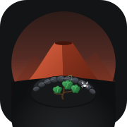
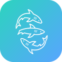
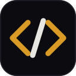

  

&nbsp;
&nbsp;
&nbsp;

  

##  Sobre mí

<table>
<tr>
<td width="62%" valign="top">

Desarrollo aplicaciones web **de principio a fin**: del diseño de la base de datos al despliegue. Trabajo con el ecosistema JavaScript (**Next.js, React, Vue 3**) en el frontend y con **Laravel, Node.js** y bases de datos relacionales en el backend, priorizando código mantenible y tiempos de carga rápidos.

 &nbsp;Técnico en Desarrollo de Aplicaciones Web · CIFP Zonzamas (2023 – 2025) 
 &nbsp;Prácticas en  (Next.js / React) y **Miart Canarias** (PHP) 
 &nbsp;Ahora mismo profundizando en Next.js, Laravel y arquitectura moderna 
 &nbsp;Busco oportunidades como desarrollador **full‑stack**

</td>
<td width="38%" align="center" valign="middle">

**Antonio Morera Marrero** 
*Full‑Stack Developer* 
 Lanzarote, Islas Canarias

</td>
</tr>
</table>

##  Tech Stack

**Frontend**  

 

**Backend y bases de datos**  

 

**Herramientas y despliegue**  

##  Proyectos destacados

Aplicaciones reales en producción y los problemas que resuelven

 

<table>
<tr>
<td width="50%" valign="top">
 

&nbsp;&nbsp;<a href="https://deacapalla.vercel.app/"><b>De acá pa allá</b></a> 
&nbsp;&nbsp;
  
Suite PWA local-first para convertir y editar documentos PDF, imágenes, audio y vídeo en el navegador sin que los archivos salgan del dispositivo. Soporte offline.
  

  
<a href="https://deacapalla.vercel.app/"><b>Ver herramienta →</b></a>
  

 
La app de Android incluye además descarga de música y vídeos de YouTube.
  
</td>
<td width="50%" valign="top">
 

&nbsp;&nbsp;<a href="https://meloffy.com/"><b>Meloffy</b></a> 
&nbsp;&nbsp;
  
Crea y escucha listas de reproducción colaborativas de YouTube en tiempo real con amigos, desde el navegador, sin instalar aplicaciones ni crear cuentas complejas.
  

  
<a href="https://meloffy.com/"><b>Ver proyecto →</b></a>
  
</td>
</tr>
<tr>
<td width="50%" valign="top">
 

&nbsp;&nbsp;<a href="https://examenestest.vercel.app/"><b>examenestests</b></a> 
&nbsp;&nbsp;
  
Evita perder horas redactando cuestionarios a mano: convierte apuntes en PDF y Word en simulacros de examen cronometrados con corrección automática y estadísticas de fallos.
  

  
<a href="https://examenestest.vercel.app/"><b>Ver demo →</b></a>
  
</td>
<td width="50%" valign="top">
 

&nbsp;&nbsp;<a href="https://telamonet.vercel.app/home"><b>TelamoNet</b></a> 
&nbsp;&nbsp;
  
Centraliza la comunicación entre estudiantes y centros educativos: resuelve dudas por asignatura con un foro estructurado y difunde eventos académicos en un mapa.
  

  
<a href="https://telamonet.vercel.app/home"><b>Ver proyecto →</b></a>
  
</td>
</tr>
<tr>
<td width="50%" valign="top">
 
 

  
Renueva la web corporativa de la empresa: catálogo de sensores urbanos en español e inglés y captación de solicitudes comerciales y de empleo.
  

  
<a href="https://orionaiot.com/es/home/"><b>Ver proyecto →</b></a>
  
</td>
<td width="50%" valign="top">
 

&nbsp;&nbsp;<a href="https://antonio-morera-marrero.vercel.app/"><b>Portfolio</b></a> 
&nbsp;&nbsp;
  
Reúne mis proyectos desplegados y trayectoria técnica, con fondo estelar en Canvas 2D a 60 FPS y sistema de filtrado dinámico multidimensional.
  

  
<a href="https://antonio-morera-marrero.vercel.app/"><b>Visitar portfolio →</b></a>
  
</td>
</tr>
</table>

##  Experiencia y formación

<table>
<tr>
<td width="24%" align="right" valign="top">
 
<b>Feb 2026 – May 2026</b> 

</td>
<td valign="top">
 
<b>Desarrollador Web</b> 
 
 Arrecife, España
  
Desarrollo web con Next.js y React. Implementación de funcionalidades en el sitio web corporativo, integración de servicios de email y analítica web, y trabajo con Tailwind CSS y componentes reutilizables.
  

  
</td>
</tr>
<tr>
<td width="24%" align="right" valign="top">
 
<b>Feb 2025 – Mar 2025</b> 

</td>
<td valign="top">
 
<b>Desarrollador Web · Miart Canarias</b> 
 Santa Cruz de Tenerife, España · remoto
  
Desarrollo web con PHP en modalidad remota.
  

  
</td>
</tr>
<tr>
<td width="24%" align="right" valign="top">
 
<b>2023 – 2025</b> 

</td>
<td valign="top">
 
<b>Técnico en Desarrollo de Aplicaciones Web · CIFP Zonzamas</b> 
 Lanzarote, España
  
Formación profesional en desarrollo web full-stack, frameworks modernos y bases de datos.
  

  
</td>
</tr>
</table>

##  GitHub Stats

 

 

### *"El código es poesía lógica que da vida a ideas"*

¿Tienes un proyecto en mente? Hablemos.

 

&nbsp;&nbsp;
&nbsp;&nbsp;

  

