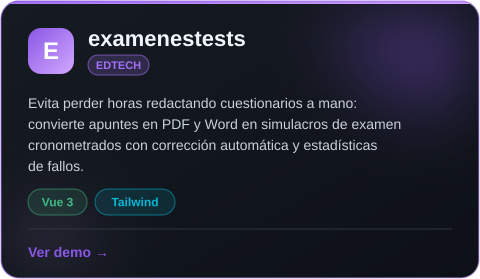
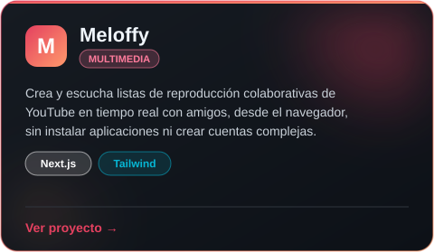
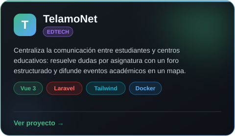
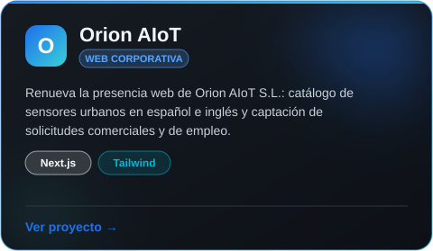
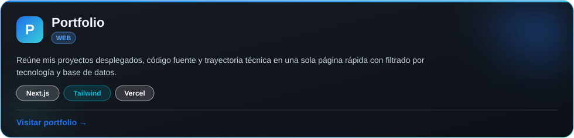
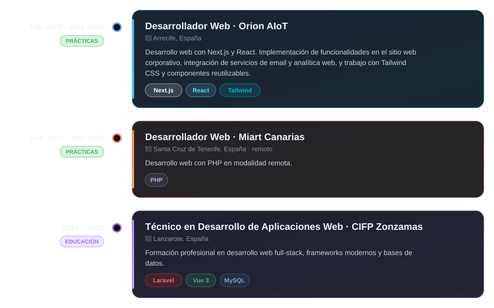

 

 

## 🌟 Sobre mí

<table>
<tr>
<td width="62%" valign="top">

Desarrollo aplicaciones web **de principio a fin**: del diseño de la base de datos al despliegue. Trabajo con el ecosistema JavaScript (**Next.js, React, Vue 3**) en el frontend y con **Laravel, Node.js** y bases de datos relacionales en el backend, priorizando código mantenible y tiempos de carga rápidos.

🎓 Técnico en Desarrollo de Aplicaciones Web · CIFP Zonzamas (2023 – 2025) 
💼 Prácticas en **Orion AIoT** (Next.js / React) y **Miart Canarias** (PHP) 
🌱 Ahora mismo profundizando en Next.js, Laravel y arquitectura moderna 
📫 Busco oportunidades como desarrollador **full‑stack**

</td>
<td width="38%" align="center" valign="middle">

**Antonio Morera Marrero** 
*Full‑Stack Developer* 
📍 Lanzarote, Islas Canarias

</td>
</tr>
</table>

## ⚙️ Tech Stack

### 🎨 Frontend

### 🧩 Backend y bases de datos

### 🛠️ Herramientas y despliegue

## 📌 Proyectos destacados

Aplicaciones reales en producción y los problemas que resuelven · pulsa una tarjeta para abrirla

  

 

 

  

## 💼 Experiencia y formación

## 📊 GitHub Stats

 

 

 

### ✨ _"El código es poesía lógica que da vida a ideas"_ ✨

¿Tienes un proyecto en mente? **Envíame una señal al universo** 🚀

